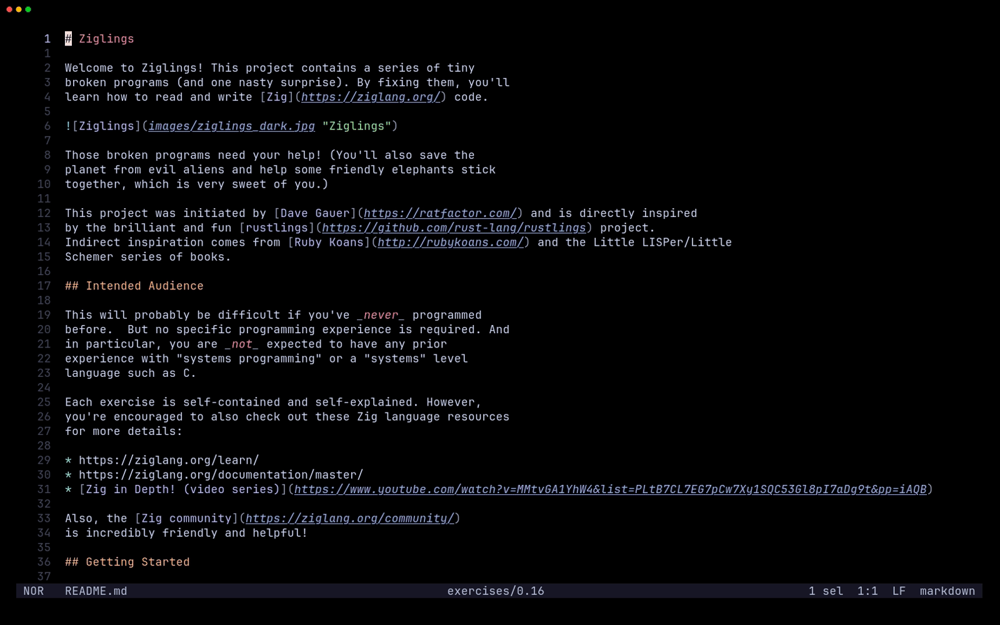

# oil.hx

A file manager plugin for [Helix](https://github.com/helix-editor/helix/) that lets you edit your filesystem like a buffer
— create, rename, and delete files and directories without ever leaving the editor.
 
> Heavily inspired by [oil.nvim](https://github.com/stevearc/oil.nvim).



---
 
## Installation
 
**1. Install the plugin-enabled fork of Helix** by following the instructions [here](https://github.com/mattwparas/helix/blob/steel-event-system/STEEL.md).
 
**2. Install oil.hx via forge:**
 
```sh
forge pkg install --git https://github.com/Ra77a3l3-jar/oil.hx.git
```
 
**3. Load the plugin** by adding this to your `init.scm`:
  
```scheme
(require "oil/oil.scm")

;; Optional: set defaults (both #false by default)
;; (oil-configure! show-dotfiles show-git-ignored)
(oil-configure! #false #false)
```

oil.hx depends on [notify.hx](https://github.com/chuwy/notify.hx) and pulls it in automatically via `forge`
its messages (saved/renamed/deleted files and errors) are shown as popup notifications with no extra setup.

---

## Usage
 
### Commands
 
| Command | Description |
|---|---|
| `:oil` | Open the file manager in the current directory |
| `:oil-enter` | Enter the directory under the cursor |
| `:oil-up` | Navigate to the parent directory |
| `:oil-save` | Apply all pending edits to the filesystem |
| `:oil-refresh` | Reload the buffer, discarding unsaved changes |
| `:oil-close` | Close the buffer |
| `:oil-yank` | Yank (copy) the entry under the cursor to the oil clipboard |
| `:oil-cut` | Cut the entry under the cursor to the oil clipboard |
| `:oil-paste` | Paste the oil clipboard entry into the current directory |
| `:oil-clipboard-clear` | Clear the oil clipboard |
| `:oil-root` | Jump to the git repository root (or helix cwd) |
| `:oil-toggle-hidden` | Toggle visibility of hidden dotfiles and directories |
| `:oil-toggle-git-ignored` | Toggle visibility of git-ignored files and directories |
| `:oil-toggle-metadata` | Toggle inline file permissions, hard-link count, and size |

### Git support

When inside a git repository, oil.hx automatically runs `git status` and shows inline hints next to each entry:

| Hint | Meaning |
|---|---|
| `~` | Modified |
| `+` | Staged (new file) |
| `→` | Renamed |
| `?` | Untracked |
| `!` | Ignored |

### Keybindings (optional)

**Global shortcuts**

These bindings work in every buffer. Add either the `config.toml` or the `init.scm`.
 
**`config.toml`:**
```toml
[keys.normal.space.o]
o = ":oil"
e = ":oil-enter"
b = ":oil-up"
g = ":oil-root"
s = ":oil-save"
r = ":oil-refresh"
q = ":oil-close"
h = ":oil-toggle-hidden"
i = ":oil-toggle-git-ignored"
t = ":oil-toggle-metadata"

[keys.normal.space.o.m]
y = ":oil-yank"
x = ":oil-cut"
p = ":oil-paste"
c = ":oil-clipboard-clear"
```
 
**`init.scm`:**
```scheme
(require "helix/keymaps.scm")

(keymap (global)
  (normal
    (space
      (o
        (o ":oil")
        (e ":oil-enter")
        (b ":oil-up")
        (g ":oil-root")
        (s ":oil-save")
        (r ":oil-refresh")
        (q ":oil-close")
        (h ":oil-toggle-hidden")
        (i ":oil-toggle-git-ignored")
        (t ":oil-toggle-metadata")
        (m
          (y ":oil-yank")
          (x ":oil-cut")
          (p ":oil-paste")
          (c ":oil-clipboard-clear"))))))
```

These bindings group oil commands under `<space>o` and clipboard operations under `<space>om`.
For example, `<space>oo` opens oil, `<space>os` applies edits, and `<space>omy` copies the entry under the cursor.

**Shortcuts only in the oil buffer**

Alternatively, add the following to `init.scm` after `(require "oil/oil.scm")`.
Open oil with `:oil`, then use single keys such as `-` to go up, `ret` which is ENTER key to enter a directory or open a file, and `w` to apply edits.

**`init.scm`:**
```scheme
(require "helix/keymaps.scm")

(define oil-keymaps
  (hash
    "normal"
    (hash
      "-"  ":oil-up"
      "I"  ":oil-toggle-git-ignored"
      "X"  ":oil-cut"
      "c"  ":oil-clipboard-clear"
      "h"  ":oil-toggle-hidden"
      "p"  ":oil-paste"
      "q"  ":oil-close"
      "ret" ":oil-enter"
      "w"  ":oil-save"
      "y"  ":oil-yank")))

(define oil-keybindings (deep-copy-global-keybindings))
(merge-keybindings oil-keybindings oil-keymaps)
(set-global-buffer-or-extension-keymap
  (hash OIL-BUFFER-NAME oil-keybindings))
```

The header line shows active flags: `[+h]` when dotfiles are visible, `[+i]` when git-ignored files are visible.

---

## Credits
 
The concept and workflow are directly inspired by [oil.nvim](https://github.com/stevearc/oil.nvim) by stevearc.
This is an adaptation of that idea for the Helix + Steel ecosystem.
